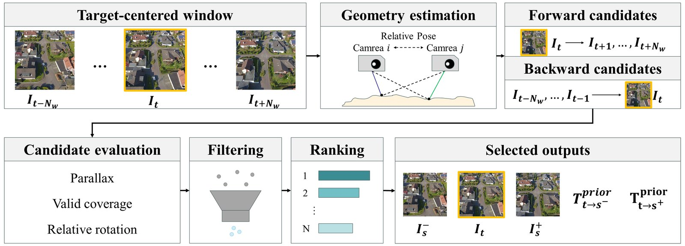
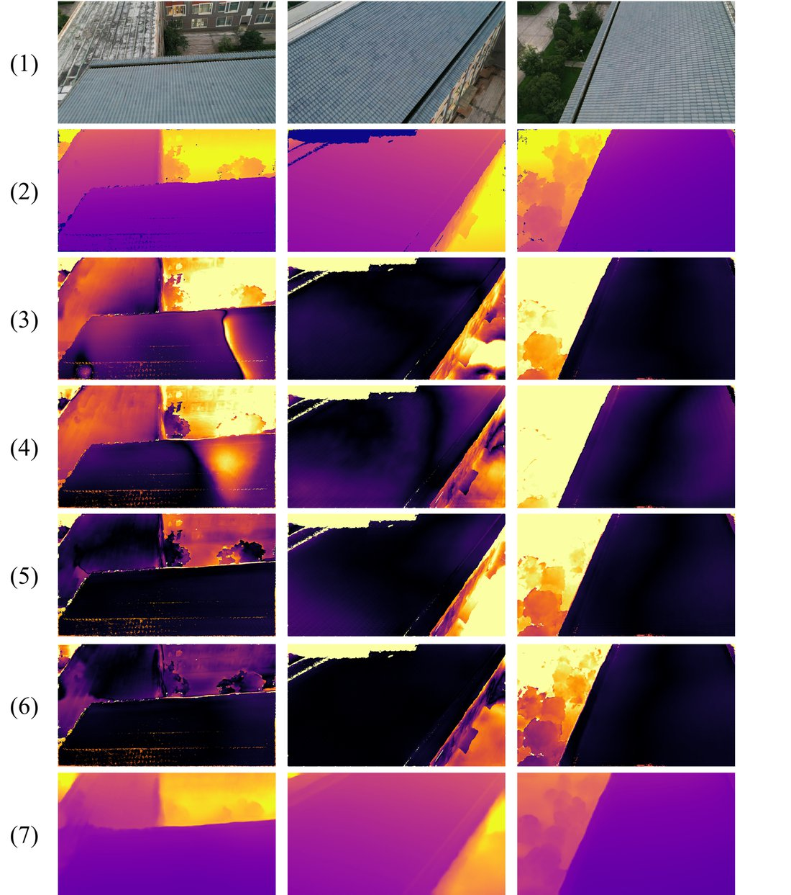

<div align="center">

# Enhancing Training-Time Geometric Supervision for Self-Supervised Monocular Depth Estimation from UAV Imagery

**Xiaotian Yang** · **Tomohiro Fukuda**

The University of Osaka

[](#citation)
[-lightgrey)](LICENSE)
[](#installation)
[](#installation)

</div>

---

Self-supervised depth learning from UAV videos depends on **how good the training-time geometric
supervision is**. Uneven flight speed makes fixed temporal offsets give too little or too much
parallax, and large camera rotations make PoseNet unreliable, so auto-masking throws away pixels
that could still supervise the depth network. We keep the MonoViT depth network unchanged and
improve the supervision instead:

- **Parallax-guided triplet construction** — for every target frame, VGGT estimates local geometry
  offline, and the backward / forward source frames whose rotation-compensated parallax is closest
  to a preferred value are selected.
- **Prior-guided pose refinement** — the VGGT rotation prior (as a pixel-level rotation flow) and
  translation prior (as a direction–magnitude embedding) are fed into PoseNet, which predicts
  residual corrections around the prior instead of regressing the pose from scratch.
- **No inference overhead** — both components are used only during training; inference runs the
  depth network alone.

<p align="center">
  
  <br><em>Overall framework: (a) parallax-guided triplet construction, (b) self-supervised training with prior-guided pose refinement.</em>
</p>

## Contents

- [Method](#method)
- [Results](#results)
- [Installation](#installation)
- [Data](#data)
- [Training triplets](#training-triplets)
- [Training](#training)
- [Repository structure](#repository-structure)
- [Citation](#citation)
- [License and acknowledgements](#license-and-acknowledgements)

## Method

### Parallax-guided triplet construction (paper Section 3.2)

<p align="center">
  
</p>

For each target frame, VGGT is run once on a window of up to *N*<sub>w</sub> frames on each side.
For every candidate source frame, the target depth is reprojected twice — with the full relative pose
and with the rotation only — and the pixel distance between the two gives the
**rotation-compensated parallax**. Candidates whose relative rotation exceeds θ<sub>max</sub> or whose
valid coverage is below ρ<sub>min</sub> are discarded; the remaining ones are ranked by a Gaussian
score around the preferred parallax δ\* = γ · min(H, W). The best candidate on each side forms the
triplet, and the corresponding VGGT relative poses are kept as pose priors.

### Prior-guided pose refinement (paper Section 3.3)

- The rotation prior is converted into a rotation flow F<sub>R</sub>(x) = π(K R<sub>prior</sub> K<sup>-1</sup>x) − x.
  It passes through its own convolutional stem and is fused with the image features after the first
  layer of the ResNet-18 pose encoder.
- The translation prior is split into a unit direction and a magnitude, embedded by a small MLP,
  broadcast over the pose feature map and fused with the visual features by a 1×1 convolution.
- The decoder predicts a residual rotation Δω, a scale s and a residual translation Δt:
  R = ΔR(Δω) · R<sub>prior</sub>, t = (1 + s) · t<sub>prior</sub> + Δt.
  The output layers are zero-initialised, so training starts exactly from the prior pose.

## Results

All methods are trained on the same parallax-guided triplets with the same resolution and protocol.
Below are MonoViT (our baseline), GasMono (the strongest competitor) and ours; the full comparison is
in Tables 2–4 of the paper. Lower is better for the first four metrics, higher is better for δ.

| Dataset | Method | AbsRel | SqRel | RMSE | RMSElog | δ<1.25 | δ<1.15 | δ<1.05 |
|---|---|---|---|---|---|---|---|---|
| UAVid-China | MonoViT | 0.0588 | 0.1317 | 0.9570 | 0.1118 | **0.9681** | 0.9303 | 0.6772 |
| | GasMono | 0.0600 | 0.1315 | 0.9706 | 0.1129 | 0.9675 | 0.9280 | 0.6627 |
| | **Ours** | **0.0575** | **0.1287** | **0.9397** | **0.1104** | 0.9670 | **0.9322** | **0.7014** |
| UAVid-Germany | MonoViT | 0.0502 | 0.0410 | 0.3602 | 0.0817 | 0.9725 | 0.9463 | 0.7048 |
| | GasMono | **0.0480** | **0.0400** | 0.3589 | **0.0801** | **0.9748** | **0.9488** | **0.7267** |
| | **Ours** | 0.0483 | 0.0402 | **0.3576** | 0.0803 | 0.9739 | 0.9466 | 0.7227 |
| UAV-ula | MonoViT | 0.0752 | 0.0627 | 0.2966 | 0.1144 | 0.9370 | 0.8857 | 0.6188 |
| | GasMono | 0.0689 | 0.0526 | 0.2786 | 0.1063 | 0.9451 | 0.8999 | **0.6323** |
| | **Ours** | **0.0621** | **0.0396** | **0.2534** | **0.0976** | **0.9599** | **0.9117** | 0.6176 |

<p align="center">
  
  <br><em>UAV-ula. Rows: (1) input, (2) reference depth, (3)–(6) absolute error of MonoViT, MRFEDepth,
  GasMono and ours (brighter = larger error), (7) our predicted depth.</em>
</p>

<p align="center">
  
  <br><em>Fraction of pixels kept by auto-masking during training on UAVid-China. Better pose
  estimates keep more pixels for photometric supervision, especially early in training.</em>
</p>

## Installation

Tested with Python 3.10, PyTorch 2.8 (CUDA 12.6) on an RTX 4090.

```bash
# 1) environment
conda create -n uavdepth python=3.10 -y
conda activate uavdepth

# 2) PyTorch (pick the build for your CUDA version: https://pytorch.org/get-started/)
pip install torch==2.8.0 torchvision==0.23.0 --index-url https://download.pytorch.org/whl/cu126

# 3) other Python packages
pip install -r requirements.txt

# 4) mmcv-full and mmsegmentation, used by the MPViT encoder of MonoViT
pip install -U openmim
mim install "mmcv-full==1.7.2"        # compiled from source for recent PyTorch (needs the CUDA toolkit)
pip install mmsegmentation==0.30.0
```

**Pretrained encoder.** Download the ImageNet-pretrained MPViT-S weights `mpvit_small.pth` from the
[MPViT repository](https://github.com/youngwanLEE/MPViT) and put them at `pretrained/mpvit_small.pth`
(or set `MPVIT_CKPT=/path/to/mpvit_small.pth`).

**Logging.** Training logs go to [Weights & Biases](https://wandb.ai/). Run `wandb login`, or set
`WANDB_MODE=offline` to log locally.

**VGGT (optional).** Only needed to rebuild the training triplets; training with the provided
triplets does not need it.

```bash
git clone https://github.com/facebookresearch/vggt.git
pip install -e vggt          # the VGGT-1B weights are downloaded from Hugging Face on first use
```

## Data

Images and reference depths are not redistributed. Please obtain them from the dataset providers:

- **UAVid 2020**, China and Germany subsets — <https://uavid.nl/>. Frames were sampled at 5 fps
  (China) and 10 fps (Germany), and obvious static frames were removed.
- **UAV-ula** (Yu et al., 2023), sequences 167–428, at 1 fps.

Expected layout under `DATA_ROOT` (default `./data`):

```
data/
├── UAVid2020/
│   ├── China/
│   │   ├── Train/seq10/data_1280/0000000000.jpg ...
│   │   ├── Validation/...
│   │   └── Test/...
│   └── Germany/                 # same structure as China
└── UAV-ula/
    ├── Train/DJI_0167/image_02/data/0000000000.jpg ...
    ├── Validation/...
    └── Test/...
```

Sequence folders and frame names must match those in `triplets/*/*/triplets.jsonl.gz` and
`methods/splits/`.

## Training triplets

We release the selected triplets and VGGT pose priors for every setting reported in the paper, so the
experiments can be reproduced without running VGGT.

| Folder (`triplets/<dataset>/tri_win<N_w>_…`) | γ | θ<sub>max</sub> | Used in |
|---|---|---|---|
| `…_disp0.05_lap0_rot10d_U0.5_S0` | 0.05 | 10° | **final setting** (Tables 1–8, 11) |
| `…_disp0.05_lap0_rot20d_U0.5_S0` | 0.05 | 20° | Table 9 |
| `…_disp0.05_lap0_rot1d_U0.5_S0` | 0.05 | 1° | Table 9 |
| `…_disp0.03_lap0_rot10d_U0.5_S0` | 0.03 | 10° | Table 10 |
| `…_disp0.07_lap0_rot10d_U0.5_S0` | 0.07 | 10° | Table 10 |

*N*<sub>w</sub> is 20 for UAVid-China, 10 for UAVid-Germany and 5 for UAV-ula. Each folder contains

- `triplets.jsonl.gz` — one record per target frame: selected backward / forward frames, VGGT
  intrinsics (`K_t`, `K_prev`, `K_next`) and relative pose priors (`T_prev_to_t`, `T_next_to_t`) at 518×294;
- `run_config.json` — the exact builder arguments;
- `sequences_summary.json` — frame and triplet counts per sequence.

Decompress before training:

```bash
find triplets -name 'triplets.jsonl.gz' -exec gunzip -k {} \;
```

<details>
<summary><b>Rebuilding the triplets with VGGT</b></summary>

```bash
# 1) list the frames of every sequence
python triplet_construction/uav_frame_metrics.py --root_dir <images> --out_dir <metrics>

# 2) parallax-guided selection; defaults are the final paper settings, set --window per dataset
python triplet_construction/vggt_triplet_builder_disp_only.py \
    --image_root <images> --metrics_root <metrics> --out_root <output> --window 20
```

`<images>` holds one sub-folder per sequence (training and validation sequences together).
`--help` shows how every argument maps to the paper. Final settings: valid parallax 2–80 px,
ρ<sub>min</sub> = 0.5, θ<sub>max</sub> = 10°, γ = 0.05, β = 0.35 (fixed in the code), VGGT input 518×294.

</details>

## Training

```bash
python train_tri.py --preset china      # or: germany, ula
```

The preset uses the final paper configuration: MPViT-S DepthNet, prior-guided ResNet-18 PoseNet
(`--methods MonoViT_VGGT_RFlow_TInj`), 512×288 input, batch size 8, Adam with a constant learning
rate of 1e-4, 40 epochs and seed 42. Options given on the command line override the preset, e.g.

```bash
# Table 9: θmax = 20° on UAV-ula
python train_tri.py --preset ula \
    --triplet_root triplets/UAV-ula/tri_win5_disp0.05_lap0_rot20d_U0.5_S0
```

Checkpoints are written to `LOG_ROOT` (default `./weights`).

## Repository structure

| Path | Content | Paper |
|---|---|---|
| `triplet_construction/` | Frame listing and parallax-guided triplet construction with VGGT | Section 3.2 |
| `triplets/` | Precomputed triplets and pose priors | Tables 1, 9, 10 |
| `methods/networks/pose_flow_encoder.py` | ResNet-18 pose encoder with rotation-flow input | Section 3.3 |
| `methods/networks/pose_tprior_decoder.py` | Translation-prior embedding, fusion and residual pose head | Section 3.3 |
| `methods/networks/monovit/` | MonoViT depth network (MPViT-S encoder) | Section 4.1.2 |
| `methods/losses/monodepth2/` | Photometric and smoothness losses, minimum reprojection, auto-masking | Section 3.4 |
| `methods/splits/` | Train / validation / test frame lists | Section 4.1.1 |
| `train_tri.py` | Training entry with per-dataset presets | Section 4.1.2 |

## Citation

The citation will be added after publication.

## License and acknowledgements

This code builds on [Monodepth2](https://github.com/nianticlabs/monodepth2) and is released under
the Monodepth2 license, which allows non-commercial use only (see [LICENSE](LICENSE)).
We thank the authors of [MonoViT](https://github.com/zxcqlf/MonoViT),
[MPViT](https://github.com/youngwanLEE/MPViT), [VGGT](https://github.com/facebookresearch/vggt)
and [GasMono](https://github.com/zxcqlf/GasMono) for releasing their code.
The pose priors in `triplets/` were produced with VGGT; please also follow the VGGT license when using them.
