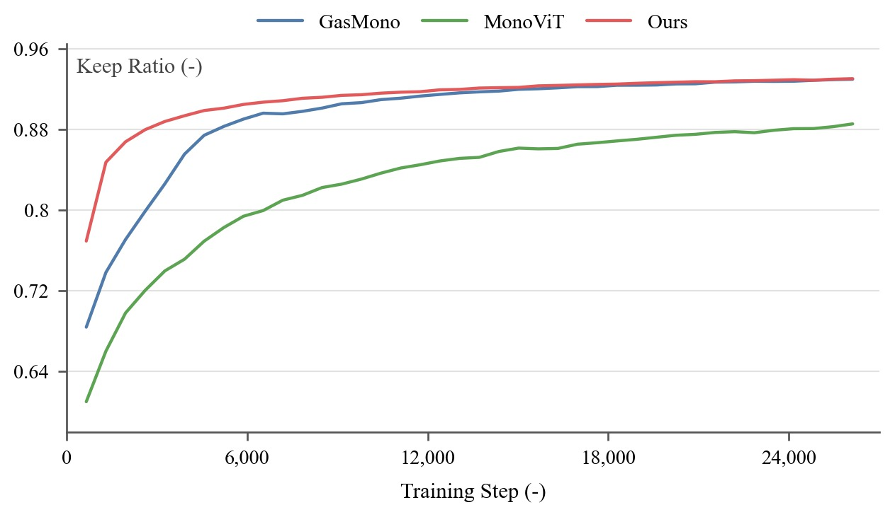

<div align="center">

<h1>Enhancing Training-Time Geometric Supervision<br>for Self-Supervised Monocular Depth Estimation<br>from UAV Imagery</h1>

**Xiaotian Yang** &nbsp;·&nbsp; **Tomohiro Fukuda**

The University of Osaka

<p>
<a href="#citation"></a>&nbsp;<a href="#installation"></a>&nbsp;<a href="LICENSE"></a>
</p>


</div>

## Overview

Self-supervised depth learning from UAV videos is limited by **unreliable geometric supervision
during training**: fixed frame offsets give unbalanced parallax, and large camera motions make the
estimated pose inaccurate, so many useful pixels are discarded by auto-masking.

<table>
  <tr>
    <td width="33%" valign="top"><h3>🎯 Parallax-guided triplets</h3>Source frames are chosen by their parallax to the target frame, using local geometry estimated by VGGT.</td>
    <td width="33%" valign="top"><h3>🧭 Prior-guided pose</h3>VGGT rotation and translation priors are fed into PoseNet, which only predicts a residual correction.</td>
    <td width="33%" valign="top"><h3>⚡ No inference cost</h3>Both parts are used only during training; inference runs the depth network alone.</td>
  </tr>
</table>

## Results

All methods are trained on the same triplets with the same resolution and protocol
(full tables in the paper). ↓ lower is better, ↑ higher is better.

<table>
  <thead>
    <tr><th>Dataset</th><th>Method</th><th>AbsRel ↓</th><th>SqRel ↓</th><th>RMSE ↓</th><th>RMSElog ↓</th><th>δ&lt;1.25 ↑</th><th>δ&lt;1.15 ↑</th><th>δ&lt;1.05 ↑</th></tr>
  </thead>
  <tbody>
    <tr><td rowspan="3"><b>UAVid-China</b></td><td>MonoViT</td><td>0.0588</td><td>0.1317</td><td>0.9570</td><td>0.1118</td><td><b>0.9681</b></td><td>0.9303</td><td>0.6772</td></tr>
    <tr><td>GasMono</td><td>0.0600</td><td>0.1315</td><td>0.9706</td><td>0.1129</td><td>0.9675</td><td>0.9280</td><td>0.6627</td></tr>
    <tr><td><b>Ours</b></td><td><b>0.0575</b></td><td><b>0.1287</b></td><td><b>0.9397</b></td><td><b>0.1104</b></td><td>0.9670</td><td><b>0.9322</b></td><td><b>0.7014</b></td></tr>
    <tr><td rowspan="3"><b>UAVid-Germany</b></td><td>MonoViT</td><td>0.0502</td><td>0.0410</td><td>0.3602</td><td>0.0817</td><td>0.9725</td><td>0.9463</td><td>0.7048</td></tr>
    <tr><td>GasMono</td><td><b>0.0480</b></td><td><b>0.0400</b></td><td>0.3589</td><td><b>0.0801</b></td><td><b>0.9748</b></td><td><b>0.9488</b></td><td><b>0.7267</b></td></tr>
    <tr><td><b>Ours</b></td><td>0.0483</td><td>0.0402</td><td><b>0.3576</b></td><td>0.0803</td><td>0.9739</td><td>0.9466</td><td>0.7227</td></tr>
    <tr><td rowspan="3"><b>UAV-ula</b></td><td>MonoViT</td><td>0.0752</td><td>0.0627</td><td>0.2966</td><td>0.1144</td><td>0.9370</td><td>0.8857</td><td>0.6188</td></tr>
    <tr><td>GasMono</td><td>0.0689</td><td>0.0526</td><td>0.2786</td><td>0.1063</td><td>0.9451</td><td>0.8999</td><td><b>0.6323</b></td></tr>
    <tr><td><b>Ours</b></td><td><b>0.0621</b></td><td><b>0.0396</b></td><td><b>0.2534</b></td><td><b>0.0976</b></td><td><b>0.9599</b></td><td><b>0.9117</b></td><td>0.6176</td></tr>
  </tbody>
</table>

<table>
  <tr>
    <td width="50%" align="center"></td>
    <td width="50%" align="center"></td>
  </tr>
  <tr>
    <td align="center"><sub>UAV-ula: input, reference depth, error maps of MonoViT, MRFEDepth, GasMono and ours (brighter = larger error), our depth.</sub></td>
    <td align="center"><sub>Pixels kept by auto-masking during training (UAVid-China). More pixels supervise the depth network from the start.</sub></td>
  </tr>
</table>

## Getting started

### Installation

```bash
conda create -n uavdepth python=3.10 -y && conda activate uavdepth

# PyTorch: choose the build for your CUDA version (https://pytorch.org/get-started/)
pip install torch==2.8.0 torchvision==0.23.0 --index-url https://download.pytorch.org/whl/cu126

pip install -r requirements.txt

# mmcv-full / mmsegmentation are required by the MPViT encoder of MonoViT
pip install -U openmim
mim install "mmcv-full==1.7.2"     # built from source for recent PyTorch, needs the CUDA toolkit
pip install mmsegmentation==0.30.0
```

Then download the ImageNet-pretrained MPViT-S weights `mpvit_small.pth` from
[MPViT](https://github.com/youngwanLEE/MPViT) to `pretrained/mpvit_small.pth`
(or set `MPVIT_CKPT=/path/to/mpvit_small.pth`).
Training logs go to [Weights & Biases](https://wandb.ai/): run `wandb login`, or set `WANDB_MODE=offline`.

### Data

Images and reference depths are not redistributed. Download **UAVid 2020** (China and Germany
subsets) from <https://uavid.nl/> and **UAV-ula** from the authors of Yu et al. (2023),
and arrange them under `DATA_ROOT` (default `./data`):

```
data/
├── UAVid2020/
│   ├── China/     {Train, Validation, Test}/seq10/data_1280/0000000000.jpg ...
│   └── Germany/   {Train, Validation, Test}/...
└── UAV-ula/       {Train, Validation, Test}/DJI_0167/image_02/data/0000000000.jpg ...
```

Frames were sampled at 5 fps (China), 10 fps (Germany) and 1 fps (UAV-ula). Sequence folders and frame
names must match those listed in `triplets/` and `methods/splits/`.

### Training triplets

`triplets/` contains the selected training triplets and their VGGT pose priors for every setting in
the paper, so no VGGT inference is needed:

| Setting | γ | θ<sub>max</sub> | Used in |
|:---|:---:|:---:|:---|
| `tri_win*_disp0.05_lap0_rot10d_U0.5_S0` | 0.05 | 10° | **final model** |
| `tri_win*_disp0.05_lap0_rot20d_U0.5_S0` | 0.05 | 20° | Table 9 |
| `tri_win*_disp0.05_lap0_rot1d_U0.5_S0` | 0.05 | 1° | Table 9 |
| `tri_win*_disp0.03_lap0_rot10d_U0.5_S0` | 0.03 | 10° | Table 10 |
| `tri_win*_disp0.07_lap0_rot10d_U0.5_S0` | 0.07 | 10° | Table 10 |

Each record in `triplets.jsonl.gz` lists the target frame, the selected backward / forward source frames,
the VGGT intrinsics and the relative pose priors. Decompress them once:

```bash
find triplets -name 'triplets.jsonl.gz' -exec gunzip -k {} \;
```

### Training

```bash
python train_tri.py --preset china        # or: germany, ula
```

Each preset reproduces the final setting: MPViT-S DepthNet, prior-guided ResNet-18 PoseNet,
512×288 input, batch size 8, Adam (lr 1e-4, constant), 40 epochs, seed 42.
Any option on the command line overrides the preset, e.g. another triplet setting:

```bash
python train_tri.py --preset ula --triplet_root triplets/UAV-ula/tri_win5_disp0.05_lap0_rot20d_U0.5_S0
```

## Citation

The BibTeX entry will be added once the article is published.

## Acknowledgements

This code builds on [Monodepth2](https://github.com/nianticlabs/monodepth2) and is released under its
non-commercial license (see [LICENSE](LICENSE)). We also thank the authors of
[MonoViT](https://github.com/zxcqlf/MonoViT), [MPViT](https://github.com/youngwanLEE/MPViT),
[VGGT](https://github.com/facebookresearch/vggt) and [GasMono](https://github.com/zxcqlf/GasMono).
The pose priors in `triplets/` were produced with VGGT; please also follow its license.
