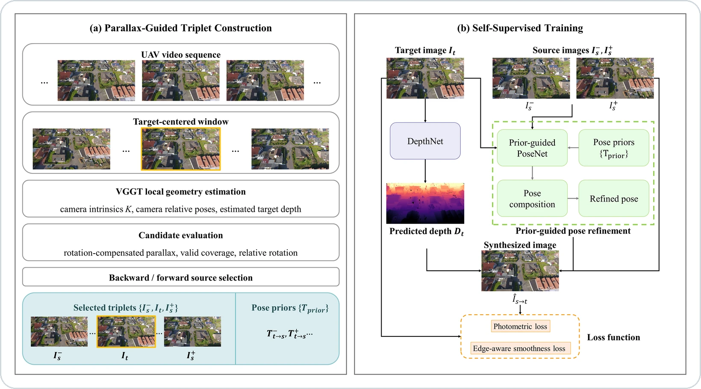

<div align="center">

<h1>Enhancing Training-Time Geometric Supervision<br>for Self-Supervised Monocular Depth Estimation<br>from UAV Imagery</h1>

<p>
<b>Xiaotian Yang</b> &nbsp;&nbsp;&nbsp; <b>Tomohiro Fukuda</b><br>
<sub>Division of Sustainable Energy and Environmental Engineering, The University of Osaka</sub>
</p>

<p>


<a href="LICENSE"></a>
</p>

<p><i>Better geometric supervision during training — the same MonoViT depth network at inference.</i></p>

<p>
<a href="#-quick-start"><b>🚀 Quick Start</b></a> &nbsp;·&nbsp;
<a href="#-data-preparation"><b>📦 Data</b></a> &nbsp;·&nbsp;
<a href="#%EF%B8%8F-training"><b>🏋️ Training</b></a> &nbsp;·&nbsp;
<a href="#-inference"><b>🔍 Inference</b></a> &nbsp;·&nbsp;
<a href="#-citation"><b>📝 Citation</b></a>
</p>



<sub><i>Parallax-guided triplet construction (a) and self-supervised training with prior-guided pose refinement (b).</i></sub>

</div>

<br>

## ✨ Highlights

<table>
<tr>
<td width="33%" valign="top">

**🎯 Parallax-guided triplets**

Source frames are chosen by their translational parallax to the target frame, using local geometry from VGGT.

</td>
<td width="33%" valign="top">

**🧭 Prior-guided PoseNet**

VGGT rotation and translation priors enter PoseNet, which predicts only a residual correction.

</td>
<td width="33%" valign="top">

**⚡ Zero inference overhead**

Both components act during training only; inference runs the MonoViT depth network alone.

</td>
</tr>
</table>

## 📰 News

- **2026-11** — Accepted by the *ISPRS Journal of Photogrammetry and Remote Sensing*. Training code and training triplets released.

## 🚀 Quick Start

```bash
# 1. environment (details below)
conda create -n uavdepth python=3.10 -y && conda activate uavdepth
pip install torch==2.8.0 torchvision==0.23.0 --index-url https://download.pytorch.org/whl/cu126
pip install -r requirements.txt

# 2. prepare the images under ./data (see Data preparation)

# 3. unpack the provided triplets and train
find triplets -name 'triplets.jsonl.gz' -exec gunzip -k {} \;
python train_tri.py --preset ula          # or: china, germany
```

## 🛠️ Installation

```bash
conda create -n uavdepth python=3.10 -y
conda activate uavdepth

# PyTorch — choose the build for your CUDA version: https://pytorch.org/get-started/
pip install torch==2.8.0 torchvision==0.23.0 --index-url https://download.pytorch.org/whl/cu126

# Python packages
pip install -r requirements.txt

# mmcv-full / mmsegmentation, required by the MPViT encoder of MonoViT
pip install -U openmim
mim install "mmcv-full==1.7.2"        # built from source for recent PyTorch (needs the CUDA toolkit)
pip install mmsegmentation==0.30.0
```

| Also needed | How |
|:---|:---|
| **MPViT-S weights** | Download `mpvit_small.pth` from [MPViT](https://github.com/youngwanLEE/MPViT) to `pretrained/mpvit_small.pth`, or set `MPVIT_CKPT=/path/to/mpvit_small.pth`. |
| **Weights & Biases** | Training logs go to [W&B](https://wandb.ai/). Run `wandb login`, or set `WANDB_MODE=offline`. |

## 📦 Data Preparation

> [!NOTE]
> Images are **not** redistributed. The repository provides the frame lists (`methods/splits/`) and the
> training triplets (`triplets/`); rebuild the images from the original datasets as follows.

All data go under `DATA_ROOT` (default `./data`):

```
data/
├── UAVid2020/
│   ├── China/
│   │   ├── Train/seq2/data_1280/0000000000.jpg ...
│   │   └── Validation/seq41/data_1280/...
│   └── Germany/                      # same structure as China
└── UAV-ula/
    ├── Train/DJI_0167/image_02/data/0000000001.jpg ...
    ├── Validation/...
    └── Test/...
```

### UAVid 2020 — China & Germany

Training frames are extracted from the original UAVid **videos** (<https://uavid.nl/>):

1. **Sample** every round(video fps / target fps)-th frame starting from the first one —
   target **5 fps** for China, **10 fps** for Germany.
2. **Resize** each frame to **1024 × 576**.
3. **Name** the frames in extraction order (`0000000000.jpg`, `0000000001.jpg`, …) and store them in
   `<Train|Validation>/<sequence>/data_1280/`.

> [!TIP]
> The paper removed obvious static frames afterwards. You do not need to: training only reads the
> frames listed in `triplets/` and `methods/splits/`, so any extra frames are ignored.

| | Train | Validation | Test |
|:---|:---|:---|:---|
| **China** | seq2–12, 16, 18, 21–28, 32–35, 37, 39, 40 *(28 seq.)* | seq41, seq42 | UAV_seq1 *(239 frames)* |
| **Germany** | seq13, 14, 15, 19, 31, 36 | seq38 | UAV_seq29, UAV_seq30 *(480 frames)* |

### UAV-ula

The UAV-ula images ([Yu et al., 2023](https://doi.org/10.1016/j.isprsjprs.2023.10.010); available from the
authors) already come at 1 fps and 1024 × 576 in the `DJI_xxxx/image_02/data/` layout. Copy the sequences
into the splits:

| Train | Validation | Test |
|:---|:---|:---|
| DJI_0167–0172, 0174–0176, 0232–0241, 0244, 0245, 0416, 0417, 0421, 0422, 0424–0426, 0428 *(29 seq.)* | DJI_0242, DJI_0427 | DJI_0166, DJI_0415 *(547 frames)* |

<details>
<summary><b>About the split files</b></summary>
<br>

`methods/splits/<UAVid2020_China | UAVid2020_Germany | UAVula_R1>/{train,val,test}_files.txt` list one frame per
line as `<sequence folder> <frame number>`.

- **train / val** — target frames of the training triplets (a few frames at the start and end of each
  sequence are not used as targets).
- **test** — evaluation frames, for reference. For UAVid they are frame numbers of the original 4K test
  sequences; the COLMAP reference depths are not released.

</details>

## 🧩 Training Triplets

`triplets/` contains the selected triplets and VGGT pose priors used in the paper — **no VGGT inference
is needed**. Unpack once:

```bash
find triplets -name 'triplets.jsonl.gz' -exec gunzip -k {} \;
```

| Setting (`triplets/<dataset>/tri_win<N>_…`) | γ | θ<sub>max</sub> | Used for |
|:---|:---:|:---:|:---|
| `…_disp0.05_lap0_rot10d_U0.5_S0` | 0.05 | 10° | ⭐ **final model** (preset default) |
| `…_disp0.05_lap0_rot20d_U0.5_S0` | 0.05 | 20° | sensitivity to θ<sub>max</sub> |
| `…_disp0.05_lap0_rot1d_U0.5_S0` | 0.05 | 1° | sensitivity to θ<sub>max</sub> |
| `…_disp0.03_lap0_rot10d_U0.5_S0` | 0.03 | 10° | sensitivity to γ |
| `…_disp0.07_lap0_rot10d_U0.5_S0` | 0.07 | 10° | sensitivity to γ |

<sub>`N` = 20 (UAVid-China), 10 (UAVid-Germany), 5 (UAV-ula). Each folder holds `triplets.jsonl(.gz)`, `run_config.json` (selection parameters) and `sequences_summary.json` (counts per sequence).</sub>

<details>
<summary><b>Record format of <code>triplets.jsonl</code></b></summary>
<br>

```jsonc
{
  "seq": "seq10/data_1280",                        // sequence folder under Train/ or Validation/
  "center": {"idx": 1, "file": "0000000001.jpg"},  // target frame
  "prev":   {"idx": 0, "file": "0000000000.jpg", "dt": -1, ...},  // backward source frame
  "next":   {"idx": 6, "file": "0000000006.jpg", "dt": 5, ...},   // forward source frame
  "K_t": [[fx, 0, cx], [0, fy, cy], [0, 0, 1]],    // VGGT intrinsics (also K_prev, K_next)
  "T_prev_to_t": [[...4x4...]],                    // VGGT relative pose priors
  "T_next_to_t": [[...4x4...]],
  "H": 294, "W": 518                               // resolution of the VGGT estimates
}
```

`prev` / `next` also store the selection statistics (rotation, coverage, median parallax, score).

</details>

## 🏋️ Training

```bash
python train_tri.py --preset china        # UAVid-China
python train_tri.py --preset germany      # UAVid-Germany
python train_tri.py --preset ula          # UAV-ula
```

Each preset reproduces the paper setting: **MPViT-S DepthNet + prior-guided ResNet-18 PoseNet**,
512 × 288 input, batch size 8, Adam (constant lr 1e-4), 40 epochs, seed 42.
Options on the command line override the preset:

```bash
# MonoViT baseline (standard PoseNet) on the same triplets
python train_tri.py --preset ula --methods MonoViT

# another triplet setting
python train_tri.py --preset ula --triplet_root triplets/UAV-ula/tri_win5_disp0.05_lap0_rot20d_U0.5_S0

# custom data / output locations
DATA_ROOT=/datasets LOG_ROOT=/experiments python train_tri.py --preset china
```

<details>
<summary><b>Frequently used options</b> (all in <code>options.py</code>)</summary>
<br>

| Option | Meaning |
|:---|:---|
| `--methods` | `MonoViT_VGGT_RFlow_TInj` (ours), `MonoViT`, `Monodepth2` |
| `--triplet_root` | triplet folder to train on |
| `--data_path`, `--split` | image root and split name (set by the preset) |
| `--num_epochs`, `--batch_size`, `--learning_rate`, `--seed` | training schedule |
| `--load_weights_folder` | resume from `…/models/weights_<epoch>` |
| `--enable_debug_metrics`, `--enable_automask_margin_viz` | auto-masking statistics and visualisations (on in the presets) |

</details>

Checkpoints are written after every epoch:

```
<LOG_ROOT>/<project>/<run name>/models/weights_<epoch>/
├── encoder.pth, decoder.pth          # DepthNet  → needed for inference
├── pose_encoder.pth, pose.pth        # PoseNet   → training only
└── adam.pth
```

## 🔍 Inference

Only the depth network is needed:

```python
import torch
from PIL import Image
import torchvision.transforms.functional as TF
from methods import networks
from layers import disp_to_depth

ckpt = "weights/UAVula_R1/<run name>/models/weights_39"

net = networks.DeepNet(type="mpvitnet").eval()
enc = torch.load(f"{ckpt}/encoder.pth", map_location="cpu")
enc.pop("height"), enc.pop("width")                        # stored training resolution
net.encoder.load_state_dict(enc)
net.decoder.load_state_dict(torch.load(f"{ckpt}/decoder.pth", map_location="cpu"))

img = Image.open("image.jpg").convert("RGB").resize((512, 288), Image.LANCZOS)
x = TF.to_tensor(img).unsqueeze(0)                          # [1, 3, 288, 512] in [0, 1]
with torch.no_grad():
    disp = net(x)[("disp", 0)]
_, depth = disp_to_depth(disp, 0.1, 150.0)                  # relative (scale-ambiguous) depth
```

> [!NOTE]
> Predictions are defined up to scale. The paper aligns them to the reference depth by per-image median scaling.

## 🗂️ Code Structure

```
├── train_tri.py                    # training entry with dataset presets
├── options.py                      # all command-line options
├── trainer.py, trainer_support.py  # training loop, pose composition, checkpointing
├── trainer_init/                   # data loaders, models, losses, optimiser
├── methods/
│   ├── datasets/                   # triplet datasets (UAVid 2020, UAV-ula)
│   ├── networks/
│   │   ├── monovit/                # MonoViT DepthNet (MPViT-S encoder + decoder)
│   │   ├── pose_flow_encoder.py    # PoseNet encoder with rotation-prior flow
│   │   └── pose_tprior_decoder.py  # translation-prior fusion + residual pose head
│   ├── losses/monodepth2/          # photometric + smoothness loss, auto-masking
│   └── splits/                     # train / val / test frame lists
└── triplets/                       # training triplets and VGGT pose priors
```

## 📝 Citation

The BibTeX entry will be added once the article is published online.

## 🙏 Acknowledgements

This code builds on [Monodepth2](https://github.com/nianticlabs/monodepth2) and is released under its
non-commercial license (see [LICENSE](LICENSE)). We thank the authors of
[MonoViT](https://github.com/zxcqlf/MonoViT), [MPViT](https://github.com/youngwanLEE/MPViT),
[VGGT](https://github.com/facebookresearch/vggt) and [GasMono](https://github.com/zxcqlf/GasMono)
for releasing their code. The pose priors in `triplets/` were produced with VGGT; please also follow its license.
