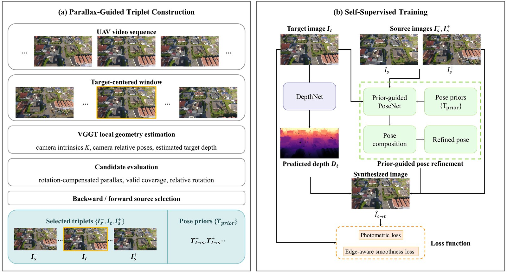

<div align="center">

<h1>Enhancing Training-Time Geometric Supervision<br>for Self-Supervised Monocular Depth Estimation<br>from UAV Imagery</h1>

**Xiaotian Yang** &nbsp;·&nbsp; **Tomohiro Fukuda** &nbsp;—&nbsp; The University of Osaka

<p>
&nbsp;&nbsp;<a href="LICENSE"></a>
</p>

</div>

Official training code for self-supervised monocular depth estimation from UAV videos.
On top of MonoViT, training uses (1) **parallax-guided triplets** whose source frames are selected
with VGGT geometry, and (2) a **prior-guided PoseNet** that refines VGGT pose priors instead of
regressing poses from scratch. Inference uses the depth network only.

<p align="center"></p>

**Contents:**
[Installation](#installation) ·
[Data](#data) ·
[Training triplets](#training-triplets) ·
[Training](#training) ·
[Inference](#inference) ·
[Code structure](#code-structure) ·
[Citation](#citation)

## Installation

```bash
conda create -n uavdepth python=3.10 -y
conda activate uavdepth

# 1. PyTorch: choose the build for your CUDA version (https://pytorch.org/get-started/)
pip install torch==2.8.0 torchvision==0.23.0 --index-url https://download.pytorch.org/whl/cu126

# 2. Python packages
pip install -r requirements.txt

# 3. mmcv-full / mmsegmentation (used by the MPViT encoder of MonoViT)
pip install -U openmim
mim install "mmcv-full==1.7.2"       # built from source for recent PyTorch; needs the CUDA toolkit
pip install mmsegmentation==0.30.0
```

**Pretrained encoder.** Download `mpvit_small.pth` (ImageNet-pretrained MPViT-S) from
[MPViT](https://github.com/youngwanLEE/MPViT) and place it at `pretrained/mpvit_small.pth`,
or point to it with `MPVIT_CKPT=/path/to/mpvit_small.pth`.

**Logging.** Training logs to [Weights & Biases](https://wandb.ai/). Run `wandb login` once,
or set `WANDB_MODE=offline` to keep logs local.

## Data

The images are not redistributed. Download **UAVid 2020** (China and Germany subsets) from
<https://uavid.nl/> and **UAV-ula** from the authors of Yu et al. (2023). Frames are used at
5 fps (China), 10 fps (Germany) and 1 fps (UAV-ula). Place them under `DATA_ROOT` (default `./data`):

```
data/
├── UAVid2020/
│   ├── China/
│   │   ├── Train/seq10/data_1280/0000000000.jpg ...
│   │   ├── Validation/...
│   │   └── Test/...
│   └── Germany/          # same structure as China
└── UAV-ula/
    ├── Train/DJI_0167/image_02/data/0000000000.jpg ...
    ├── Validation/...
    └── Test/...
```

Sequence folders and frame names must match those used in `triplets/` and `methods/splits/`.

## Training triplets

`triplets/` holds the training triplets and VGGT pose priors used in the paper, so VGGT does not
need to be run. Decompress them once:

```bash
find triplets -name 'triplets.jsonl.gz' -exec gunzip -k {} \;
```

```
triplets/
├── UAVid-China/      tri_win20_<setting>/
├── UAVid-Germany/    tri_win10_<setting>/
└── UAV-ula/          tri_win5_<setting>/
                        ├── triplets.jsonl(.gz)      # one line per target frame
                        ├── run_config.json          # selection parameters
                        └── sequences_summary.json   # frames / triplets per sequence
```

| `<setting>` | γ | θ<sub>max</sub> | Used for |
|:---|:---:|:---:|:---|
| `disp0.05_lap0_rot10d_U0.5_S0` | 0.05 | 10° | **final model** (default in `train_tri.py`) |
| `disp0.05_lap0_rot20d_U0.5_S0` | 0.05 | 20° | sensitivity to θ<sub>max</sub> |
| `disp0.05_lap0_rot1d_U0.5_S0` | 0.05 | 1° | sensitivity to θ<sub>max</sub> |
| `disp0.03_lap0_rot10d_U0.5_S0` | 0.03 | 10° | sensitivity to γ |
| `disp0.07_lap0_rot10d_U0.5_S0` | 0.07 | 10° | sensitivity to γ |

<details>
<summary>Record format of <code>triplets.jsonl</code></summary>

```jsonc
{
  "seq": "seq10/data_1280",                        // sequence folder under Train/ or Validation/
  "center": {"idx": 1, "file": "0000000001.jpg"},  // target frame
  "prev":   {"idx": 0, "file": "0000000000.jpg", "dt": -1, ...},  // backward source frame
  "next":   {"idx": 6, "file": "0000000006.jpg", "dt": 5, ...},   // forward source frame
  "K_t": [[fx, 0, cx], [0, fy, cy], [0, 0, 1]],    // VGGT intrinsics at W x H (also K_prev, K_next)
  "T_prev_to_t": [[...4x4...]],                    // VGGT relative pose priors
  "T_next_to_t": [[...4x4...]],
  "H": 294, "W": 518                               // resolution of the VGGT estimates
}
```

The `prev` / `next` entries also store the selection statistics (rotation, coverage, median parallax, score).
Which target frames are used for training or validation is decided by `methods/splits/<split>/{train,val}_files.txt`.

</details>

## Training

```bash
python train_tri.py --preset china       # UAVid-China
python train_tri.py --preset germany     # UAVid-Germany
python train_tri.py --preset ula         # UAV-ula
```

A preset fills in the paper setting: MPViT-S DepthNet + prior-guided ResNet-18 PoseNet
(`--methods MonoViT_VGGT_RFlow_TInj`), 512×288 input, batch size 8, Adam with a constant learning
rate of 1e-4, 40 epochs, seed 42, and the final triplets of that dataset.
Any option given on the command line overrides the preset:

```bash
# MonoViT baseline (standard PoseNet) on the same triplets
python train_tri.py --preset ula --methods MonoViT

# another triplet setting
python train_tri.py --preset ula --triplet_root triplets/UAV-ula/tri_win5_disp0.05_lap0_rot20d_U0.5_S0

# custom locations
DATA_ROOT=/datasets LOG_ROOT=/experiments python train_tri.py --preset china
```

Frequently used options (see `options.py` for all):

| Option | Meaning |
|:---|:---|
| `--methods` | `MonoViT_VGGT_RFlow_TInj` (ours), `MonoViT`, `Monodepth2` |
| `--triplet_root` | triplet folder to train on |
| `--data_path` / `--split` | image root and split name (set by the preset) |
| `--num_epochs`, `--batch_size`, `--learning_rate`, `--seed` | training schedule |
| `--load_weights_folder` | resume from `.../models/weights_<epoch>` |
| `--enable_debug_metrics`, `--enable_automask_margin_viz` | log auto-masking statistics and visualisations (on in the presets) |

Checkpoints are saved after every epoch:

```
<LOG_ROOT>/<project>/<run name>/models/weights_<epoch>/
    encoder.pth  decoder.pth        # DepthNet (needed for inference)
    pose_encoder.pth  pose.pth      # PoseNet (training only)
    adam.pth
```

## Inference

Only the depth network is needed. Example for a single image:

```python
import torch
from PIL import Image
import torchvision.transforms.functional as TF
from methods import networks
from layers import disp_to_depth

ckpt = "weights/UAVula_R1/<run name>/models/weights_39"

net = networks.DeepNet(type="mpvitnet").eval()
enc = torch.load(f"{ckpt}/encoder.pth", map_location="cpu")
enc.pop("height"), enc.pop("width")                       # stored training resolution
net.encoder.load_state_dict(enc)
net.decoder.load_state_dict(torch.load(f"{ckpt}/decoder.pth", map_location="cpu"))

img = Image.open("image.jpg").convert("RGB").resize((512, 288), Image.LANCZOS)
x = TF.to_tensor(img).unsqueeze(0)                         # [1, 3, 288, 512], values in [0, 1]
with torch.no_grad():
    disp = net(x)[("disp", 0)]
_, depth = disp_to_depth(disp, 0.1, 150.0)                 # relative depth (scale-ambiguous)
```

Predictions are up to scale; the paper aligns them to the reference depth by per-image median scaling.

## Code structure

```
train_tri.py                       training entry with dataset presets
options.py                         all command-line options
trainer.py, trainer_support.py     training loop, pose composition, checkpointing
trainer_init/                      builds data loaders, models, losses and optimiser
methods/
├── datasets/                      triplet datasets (UAVid 2020, UAV-ula)
├── networks/
│   ├── monovit/                   MonoViT DepthNet (MPViT-S encoder + decoder)
│   ├── pose_flow_encoder.py       PoseNet encoder with rotation-prior flow input
│   └── pose_tprior_decoder.py     translation-prior fusion and residual pose head
├── losses/monodepth2/             photometric + smoothness loss, min. reprojection, auto-masking
└── splits/                        train / val / test frame lists
triplets/                          precomputed training triplets and pose priors
```

## Citation

The BibTeX entry will be added once the article is published.

## Acknowledgements

This code builds on [Monodepth2](https://github.com/nianticlabs/monodepth2) and is released under its
non-commercial license (see [LICENSE](LICENSE)). We also thank the authors of
[MonoViT](https://github.com/zxcqlf/MonoViT), [MPViT](https://github.com/youngwanLEE/MPViT),
[VGGT](https://github.com/facebookresearch/vggt) and [GasMono](https://github.com/zxcqlf/GasMono).
The pose priors in `triplets/` were produced with VGGT; please also follow its license.
